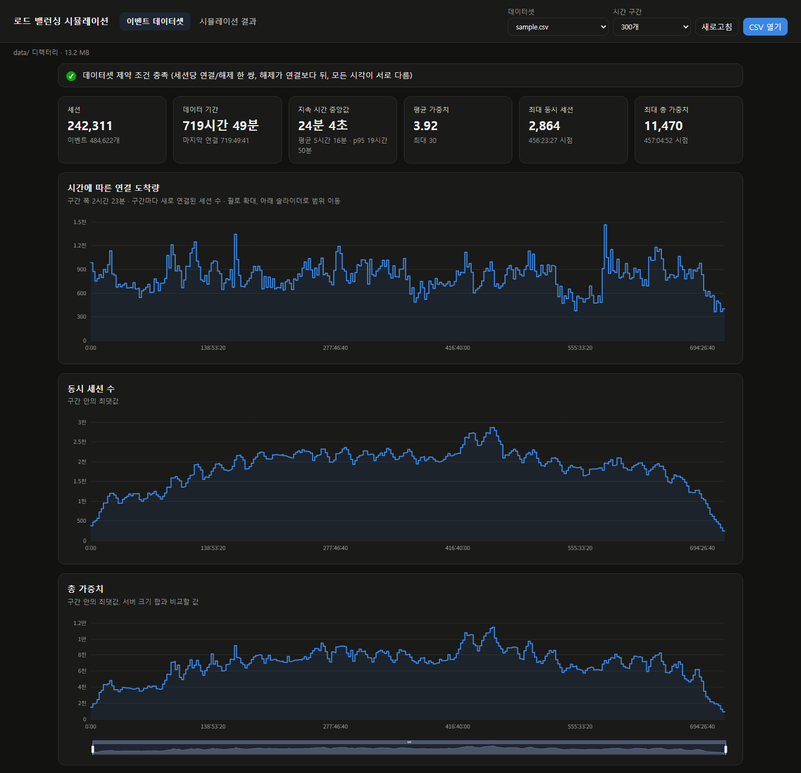
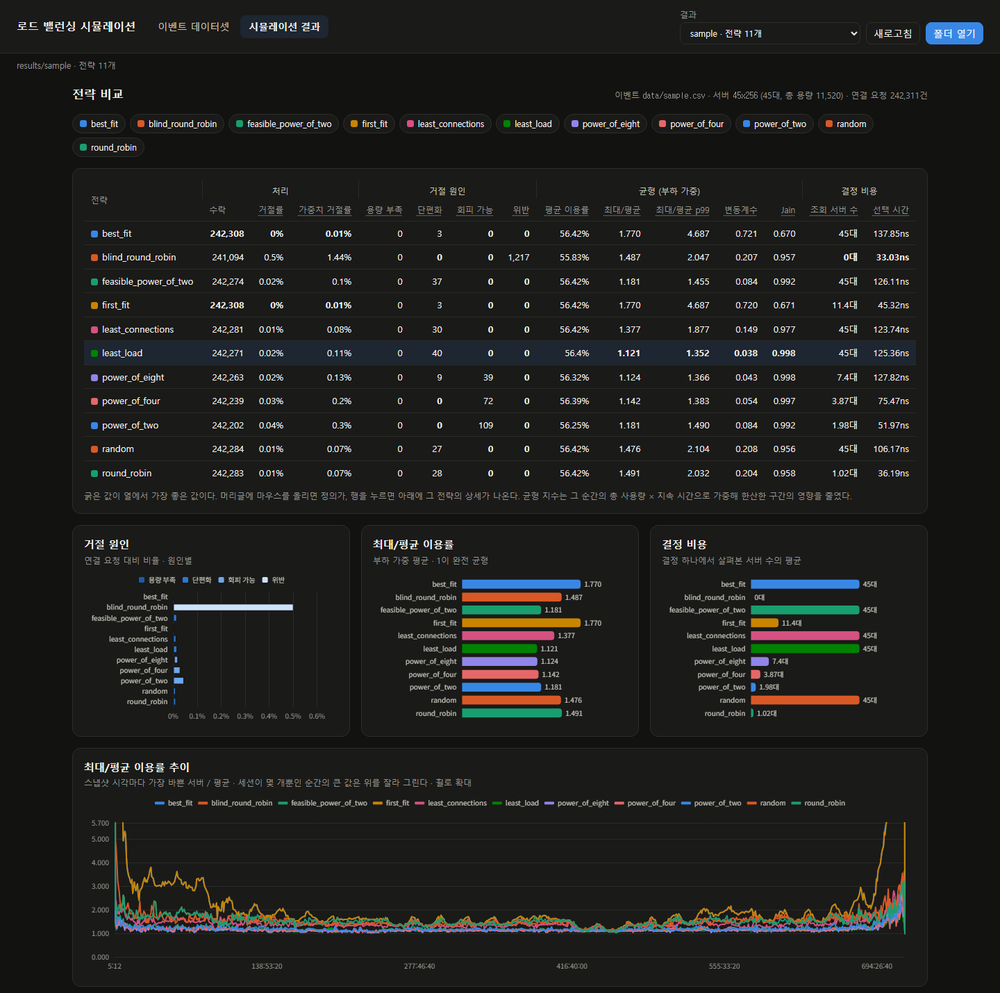

# 로드 밸런싱 전략 시뮬레이션

여러 로드 밸런싱 전략을 같은 조건에서 시뮬레이션하고 결과를 비교한다. 요구 사항은 [PROJECT_SPEC.md](PROJECT_SPEC.md).

```
lb_generator ──(이벤트 CSV)──▶ lb_simulator ──(결과 CSV)──▶ dashboard
      └──────────────────(이벤트 CSV)───────────────────────▲
```

| 프로그램 | 위치 | 문서 |
| --- | --- | --- |
| 데이터 생성기 | `generator/` | [generator/README.md](generator/README.md) |
| 시뮬레이션 엔진 | `engine/` | [engine/README.md](engine/README.md) |
| 결과 분석 및 시각화 | `dashboard/` | [dashboard/README.md](dashboard/README.md) |
| 공통 모듈 | `common/` | 이벤트 CSV, 제약 검증, 설정(`key=value`), 난수, 레지스트리 |

## 화면

이벤트 데이터셋: 연결 도착량, 동시 세션 수, 총 가중치, 지속 시간·가중치 분포



시뮬레이션 결과: 전략별 거절·균형·결정 비용 비교와 시간 추이



## 빠른 시작

C++20 컴파일러, CMake, Ninja, Node.js가 필요하다.

```bash
cmake -S . -B build -G Ninja
cmake --build build
ctest --test-dir build --output-on-failure

build/engine/lb_simulator events=data/sample.csv servers=45x256 strategy=all   # results/sample/<전략>/
npm --prefix dashboard install
npm --prefix dashboard run dev                                                  # http://localhost:5173
```

`data/sample.csv`는 저장소에 들어 있는 실제 데이터 표본이다 (아래 [데이터셋](#데이터셋)).
Windows에서는 실행 파일 이름 뒤에 `.exe`가 붙는다.

## 시뮬레이션 명령어

### 데이터셋 만들기 (생성기)

```bash
build/generator/lb_generator --list                                   # 시나리오와 파라미터 목록
build/generator/lb_generator scenario=peak sessions=20000             # data/peak.csv
build/generator/lb_generator scenario=burst sessions=50000 seed=7 output=data/burst_7.csv
build/generator/lb_generator --config my_scenario.conf                # key=value를 파일로
```

시나리오는 `uniform`, `peak`, `burst`, `mixed`이고, 지속 시간·가중치 분포를 `exp:300`, `discrete:1=0.7,4=0.3`
같은 표기로 바꿀 수 있다. 자세한 내용은 [generator/README.md](generator/README.md).

### 시뮬레이션 실행

```bash
build/engine/lb_simulator --list                                                     # 전략과 파라미터 목록
build/engine/lb_simulator events=data/sample.csv servers=45x256 strategy=least_load  # 전략 하나
build/engine/lb_simulator events=data/sample.csv servers=45x256 strategy=all         # 전체 전략
build/engine/lb_simulator events=data/sample.csv servers=20x256,10x512 \
    strategy=round_robin,power_of_two choices=3 seed=5                               # 서버 크기 혼합, 전략 파라미터
build/engine/lb_simulator events=data/sample.csv servers=90x128 strategy=all \
    output=results/sample_90x128                                                     # 서버 구성별로 결과 분리
```

| 파라미터 | 설명 |
| --- | --- |
| `events` | 이벤트 데이터셋 CSV (필수) |
| `servers` | 서버 구성 (필수). `크기` 또는 `개수x크기`를 쉼표로 나열. 서버 ID는 이 순서대로 0부터 |
| `strategy` | 전략 이름 (필수). 쉼표로 여러 개, `all`이면 전체 |
| `output` | 결과 디렉터리. 기본값은 `results/<events 파일 이름>` |
| `seed`, `choices` 등 | 전략 파라미터 (`--list`로 확인) |
| `hot_threshold`, `samples`, `sample_interval` | 포화 판정 이용률(0.9), 시간 추이 스냅샷 수(1000)와 간격 |

실행이 끝나면 전략별 요약 표를 표준 에러로 출력하고, 결과를 `<output>/<전략>/`에 CSV로 쓴다.
결과 파일과 지표의 의미는 [engine/README.md](engine/README.md).

| 전략 | 방식 |
| --- | --- |
| `round_robin`, `blind_round_robin` | 순서대로 돌아가며. blind는 용량을 보지 않는 기준선(위반이 생긴다) |
| `random` | 들어가는 서버 중 무작위 |
| `least_connections`, `least_load` | 세션 수 / 이용률이 가장 낮은 서버 |
| `first_fit`, `best_fit` | ID 순 첫 서버 / 넣은 뒤 남는 용량이 가장 작은 서버 |
| `power_of_two`, `power_of_four`, `power_of_eight` | 무작위 후보 d개(2·4·8) 중 이용률이 가장 낮은 서버 |
| `feasible_power_of_two` | 들어가는 서버만 모아 그중 무작위 둘을 비교 |

### 결과 보기 (대시보드)

```bash
npm --prefix dashboard run dev
```

`data/*.csv`와 `results/*/*`를 실행할 때마다 다시 읽으므로, 새 데이터셋이나 결과를 만든 뒤 **새로고침**만 누르면 된다.
다른 위치를 보려면 `LB_DATA_DIR`, `LB_RESULTS_DIR` 환경 변수로 바꾸거나 화면의 **CSV 열기**, **폴더 열기**를 쓴다.

## 사용 시 유의사항

**서버 총용량은 데이터셋의 최대 총 가중치와 비교해 정한다.**
대시보드 이벤트 화면의 "최대 총 가중치"(sample.csv는 11,470)보다 총용량이 작으면 어떤 전략도 다 받을 수 없어
`capacity` 거절이 결과를 좌우한다. 전략 차이를 보려면 이보다 조금 넉넉하게 잡는다.
`sample.csv`는 `45x256`(총 11,520)이 거의 빠듯한 구성이다.

**서버 크기는 가장 큰 세션 크기와 비교해 정한다.**
총용량이 같아도 서버가 작으면(세션의 몇 배 안 되면) 고르게 나누는 전략(`least_load`, power of d 계열)이
큰 세션이 들어갈 자리를 남기지 못해 거절이 크게 는다. 서버가 충분히 크면 전략 간 차이가 거의 사라진다.
`sample.csv`의 세션 가중치는 2, 4, 8, 24, 30이다.

**결과 폴더는 `<데이터셋>/<전략>`이라 같은 데이터셋으로 다시 돌리면 덮어쓴다.**
서버 구성이나 시드를 바꿔 비교할 때는 `output=results/<이름>`으로 폴더를 나눈다.
대시보드는 이 폴더 하나를 비교 그룹 하나로 보여 준다.

**전략 파라미터는 한 실행의 모든 전략에 똑같이 적용된다.**
`strategy=all choices=4`는 `power_of_two`만 바꾸지만, `seed=5`는 무작위를 쓰는 모든 전략에 적용된다.
같은 실행에서 후보 수를 비교하려면 `power_of_two`, `power_of_four`, `power_of_eight`를 함께 고른다.
읽지 않은 키(오타 포함)를 넘기면 실행하지 않고 오류를 낸다.

**같은 데이터셋·서버 구성·시드는 항상 같은 결과를 낸다.** 선택 시간(ns)만 실행 환경에 따라 달라진다.
Windows 시계는 100ns 단위라 쿼리별 선택 시간은 거칠고, `select_ns_mean`(평균)이 비교에 더 믿을 만하다.

**결과가 크다.** 연결 요청마다 한 줄씩 쓰는 `assignments.csv` 때문에 결과 크기는 세션 수에 비례한다.
`sample.csv`(세션 24만 개)를 전체 전략으로 돌리면 약 110MB, 세션 240만 개면 약 1.2GB다.

**데이터와 결과는 git에 넣지 않는다.** `data/`, `results/`, `*.csv`는 무시하고, 예외는 `data/sample.csv` 하나다.
GitHub는 100MiB가 넘는 파일을 받지 않으므로 큰 데이터셋은 다시 만들어 쓴다.

## 데이터셋

| 데이터셋 | 출처 | 세션 | 크기 | 저장소 |
| --- | --- | ---: | ---: | --- |
| `sample.csv` | Azure VM 2019 트레이스, 시작·종료가 모두 관측된 VM 중 10% 무작위 | 242,311 | 14MB | 포함 |
| `uniform`, `peak`, `burst`, `mixed` | 데이터 생성기 | 설정에 따라 | | 생성 |

`sample.csv`의 세션 하나는 VM 하나이고, 가중치는 VM 코어 수, 시간 범위는 30일이다.
원본은 [Azure Public Dataset](https://github.com/Azure/AzurePublicDataset)의 `vmtable.csv`(2019)다.
